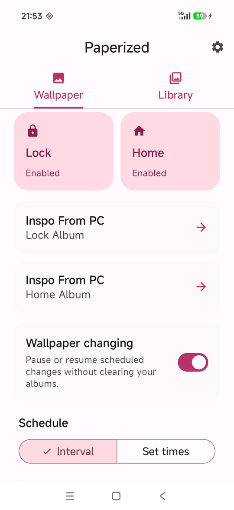
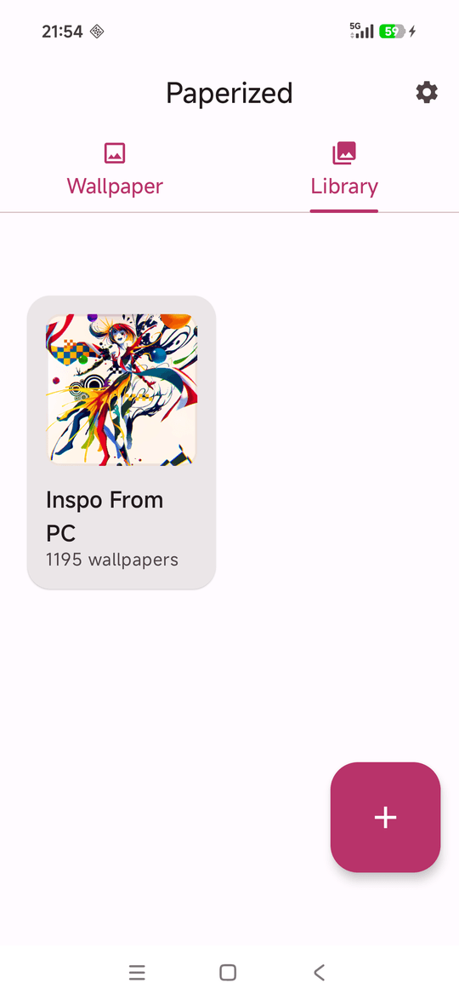
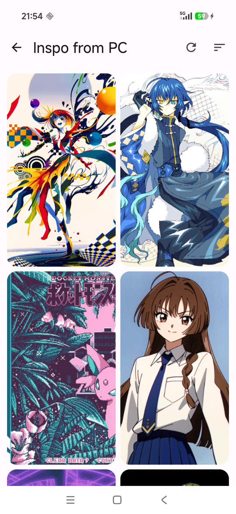
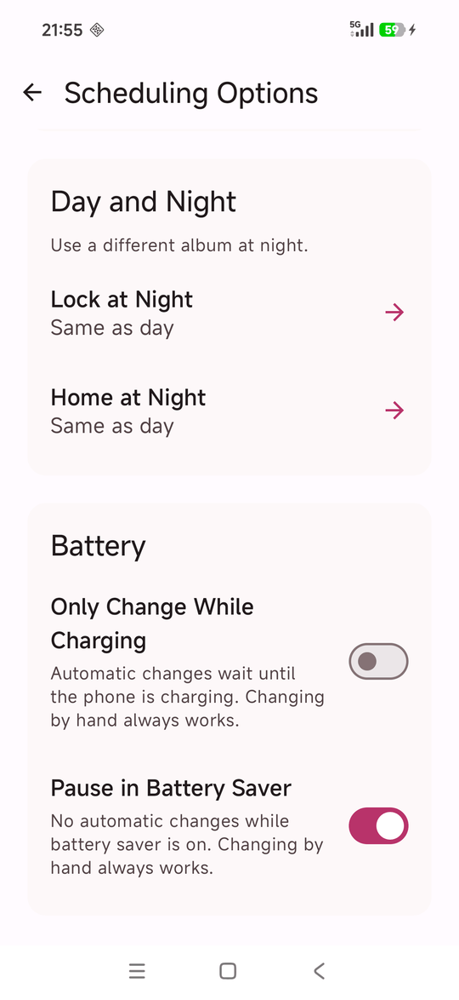

<div align="center">
  <h1>Paperized</h1>
  <p><strong>A wallpaper changer for Android: static or live, on a schedule, from your own albums</strong></p>

  [](LICENSE)
</div>

Paperized is a personal fork of [Paperize](https://github.com/Anthonyy232/Paperize) by Anthony La, based on Paperize 4.2.0. It fixes a number of bugs and adds set times of day, night albums, favourites, home-screen widgets and live auto-pan. The [CHANGELOG](CHANGELOG.md) lists everything that changed.

It's built for personal use and isn't published on any store. The source is here under the same GPL-3.0 licence as Paperize.

<p align="center">
  
  
  
  
</p>

## Features

**Albums**
- Albums of individually picked images and whole folders. Folders pick up new files and drop deleted ones by themselves (daily, and when the app opens).
- Images rotate in the album's order, which you can rearrange, or shuffled.
- Mark images as favourites or exclude them from rotation, inside folders too. Each album chooses what favourites do: a marker only, show them twice as often, or show only them.
- Rename albums and give an album its own effects that it keeps on every screen.
- Images Android no longer lets the app read are marked, with a way to grant access again.

**Changing the wallpaper**
- Static wallpapers on the home and lock screens, from the same or different albums. Screens that share an album never show the same image.
- A live wallpaper with smooth transitions, parallax, double-tap to change, change on screen off, intervals from one minute, and auto-pan for images that don't fit the screen.
- Change at an interval or at set times of day, and switch to night albums by the clock or with the phone's dark theme.
- In static mode, also change when the screen turns off or the phone is unlocked.
- Hold automatic changes until the phone is charging, or pause them in battery saver.
- Change by hand from the app, a Quick Settings tile, a launcher shortcut, or the Shuffle Home, Shuffle Lock and Shuffle Both widgets.

**Effects:** brightness, blur, vignette and a grey filter for each screen, with Fill, Fit, Stretch or None scaling. Adaptive brightness follows the light or dark theme.

**Formats:** JPG, PNG, WEBP, AVIF, HEIC/HEIF, BMP, GIF (first frame) and SVG.

**Languages:** English and Simplified Chinese.

Images stay where they are on your phone: Paperized keeps only Android's permission to read them, and stores albums and settings on the device. It has no network access.

## Installing

There are no published downloads: build the APK as below and install it with `adb install` or a file manager.

| Build | App ID | Name on the phone |
|-------|--------|-------------------|
| Release | `com.anthonyla.paperize` | Paperized |
| Debug | `com.anthonyla.paperize.debug` | Paperized Debug |

The release build keeps Paperize's app ID, so it replaces Paperize, but it's signed with a different key and can't install over it. **Uninstall Paperize first, which deletes its albums and settings** (your images aren't touched). Debug builds install alongside either.

## Building from source

Requires JDK 17 and the Android SDK (`ANDROID_HOME`, or `sdk.dir` in `local.properties`). Gradle 9.7.1 comes with the wrapper; compile SDK 37, min SDK 31 (Android 12), target SDK 36. On Windows use `gradlew.bat`.

```bash
./gradlew assembleDebug      # app/build/outputs/apk/debug/
./gradlew assembleRelease    # app/build/outputs/apk/release/app-release.apk, shrunk with R8
```

**Signing.** A release build is signed with your computer's Android debug key (`~/.android/debug.keystore`), so there's nothing to set up. Android only installs an update signed with the same key, so **back up `debug.keystore`**: on a new computer you'd otherwise have to uninstall Paperized, and lose its albums, before a new build installs.

To sign with your own key instead, create one with `keytool -genkeypair -v -keystore ~/keys/paperized-release.jks -alias paperized -keyalg RSA -keysize 4096 -validity 10000`, keep it outside the repository, and name it in a `keystore.properties` in the project root (git ignores it):

```properties
storeFile=C:/Users/you/keys/paperized-release.jks
storePassword=...
keyAlias=paperized
keyPassword=...
```

CI reads `SIGNING_KEYSTORE_PATH`, `SIGNING_STORE_PASSWORD`, `SIGNING_KEY_ALIAS` and `SIGNING_KEY_PASSWORD` instead, and the release workflow only signs when those secrets are set. Switching keys means uninstalling once. To try a release build without replacing the installed app, build it with `-Ppaperized.tryRelease`: it installs over Paperized Debug instead.

**Tests.** `./gradlew clean test lintDebug` is what CI runs on every pull request, along with a check that the database schemas in `app/schemas` are committed. Device tests (`./gradlew connectedDebugAndroidTest`) need Android 12 or newer; note that `WallpaperUtilInstrumentedTest` sets the device's wallpaper.

## Architecture

- `AlbumRepository` owns library changes. Imports, reordering, removal, covers and queue updates use Room transactions; document-provider scans run outside them, behind `DocumentSource`.
- `WallpaperRepository` owns the rotation queues and current-wallpaper records. Which images rotate (not excluded, still readable, favourites only when the album says so) is decided in one place, in the database queries.
- `WallpaperChangeRequests` is the one way to ask for a change, from the app, tile, shortcut or widgets. `WallpaperChangeService` carries requests out in the foreground and hands them to a background job when Android refuses; both go through `WallpaperRequestHandler`.
- `WallpaperController` applies static wallpapers for the service and the scheduled `WallpaperChangeWorker`, under `WallpaperChangeLock`. `WallpaperRenderer` does the image processing.
- `WallpaperScheduler` keeps the interval jobs in step with the settings; set times, the day/night switch and dark-theme redraws use their own alarms and jobs in `service/schedule`.
- The live wallpaper's engines share one queue, and only the leading engine takes images from it (`LiveEngineRules.kt`).
- The database is at version 5, with every migration from version 1 kept and tested.

Built with Kotlin, Jetpack Compose and Material 3, Hilt, Room, WorkManager, [Coil](https://coil-kt.github.io/coil/), [Zoomable](https://github.com/usuiat/Zoomable) and [Reorderable](https://github.com/Calvin-LL/Reorderable), all open source.

## Credits and licence

Paperize is created by [Anthony La](https://github.com/Anthonyy232); if you find it useful, consider [supporting him](https://github.com/sponsors/Anthonyy232). The Simplified Chinese translation started with Paperize's contributors.

Licensed under the **GNU General Public License v3.0**; see [LICENSE](LICENSE).
